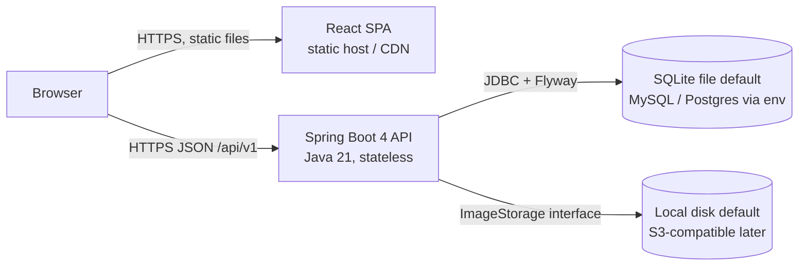
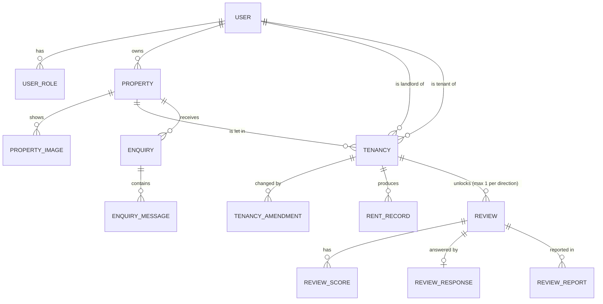
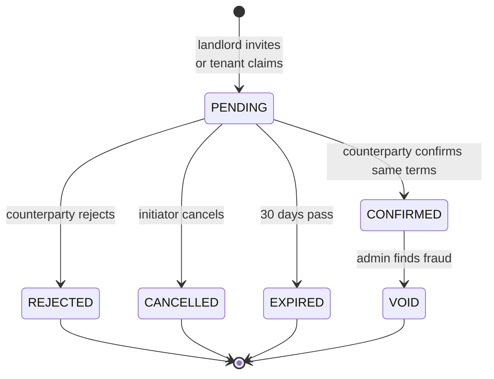
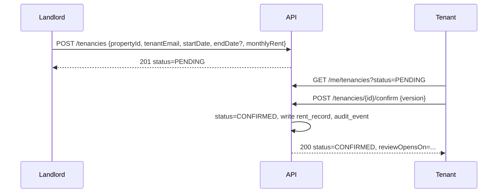
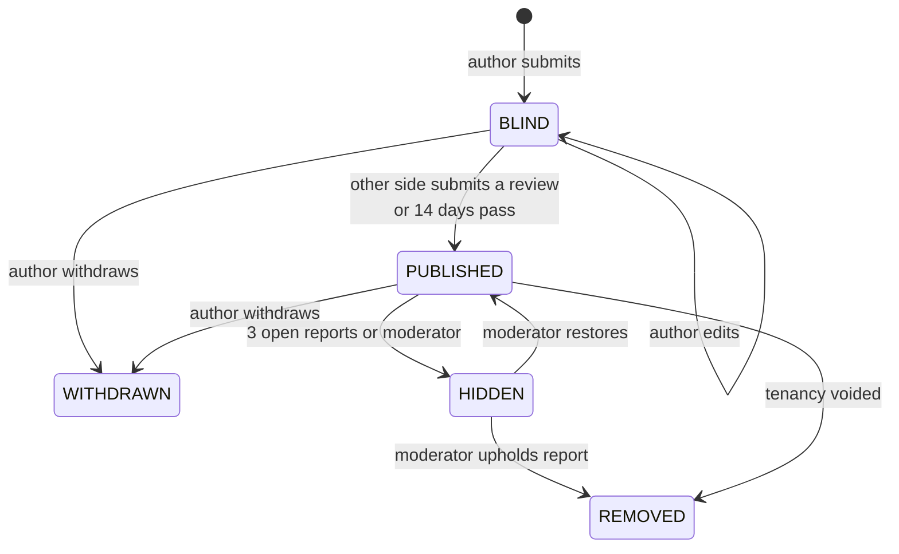
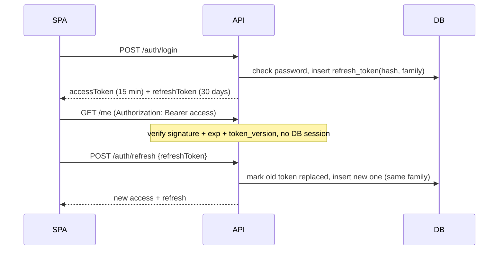
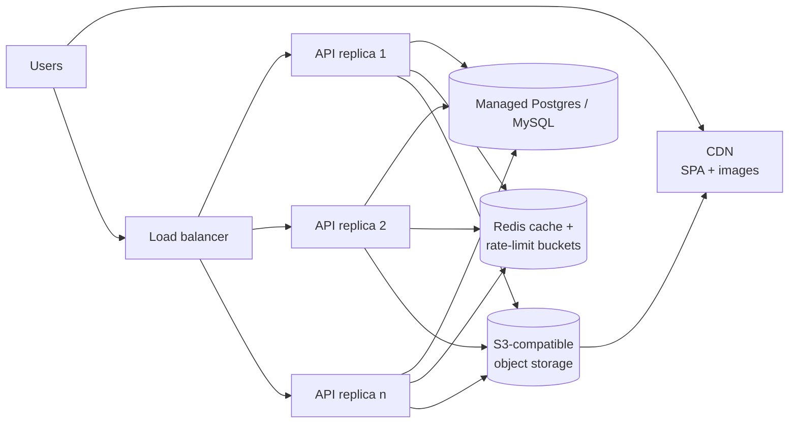

# Rentrix — System Design

Status: accepted design for the trust-platform rewrite (v0.2). This file is the
source of truth. Where an older doc in `rentrix-docs/` disagrees, this file wins.

Scope: roles, entities, trust rules, permissions, privacy, API outline, auth,
image storage, seed data, cities and the path to scale. UX and screen designs
live in `rentrix-docs/design/`; this file only lists the screens the API must
serve (section 13).

Every decision is marked **D-nn** with a one-line rationale so it can be
quoted in reviews and PRs.

---

## 1. Product in one paragraph

Rentrix is a two-sided trust platform for renting in **Bangalore and Pune**.
Three ratings exist: tenants rate landlords, landlords rate tenants, and tenants
rate properties. Every rating is tied to a **tenancy** that both the landlord
and the tenant confirmed (property + landlord + tenant + dates + rent). A
stranger cannot rate anyone, because a stranger has no confirmed tenancy. A
tenant can check a landlord's rating, a property's rating and the property's
verified rent history. A landlord can check a tenant's rating when the tenant
enquires about a listed property.

---

## 2. Architecture (three tiers)



| Tier | Technology | Notes |
|---|---|---|
| Presentation | React 19 + TypeScript + Vite SPA (`rentrix-web`) | Built to static files. Calls the API with `VITE_API_BASE_URL`. No server rendering. |
| Application | Spring Boot 4, Java 21 (`rentrix-server`) | Stateless JSON API under `/api/v1`. JWT auth. Flyway migrations. |
| Data | SQLite (default), MySQL or PostgreSQL (by env) | One schema, portable SQL. Images go through `ImageStorage`, never into the DB. |

- **D-01** Keep the existing stack (React SPA, Spring Boot 4 / Java 21, Flyway). *Rationale: it works, the team knows it, and the rewrite is about the domain, not the tools.*
- **D-02** SQLite is the default database (file at `${RENTRIX_DATA_DIR:./data}/rentrix.db`). *Rationale: zero-setup local dev and a single-node deploy with no DB server.*
- **D-03** The database is chosen with the standard `SPRING_DATASOURCE_URL`, `SPRING_DATASOURCE_USERNAME`, `SPRING_DATASOURCE_PASSWORD`. *Rationale: Spring's own variables; no custom switch code.*
- **D-04** SQLite runs with `journal_mode=WAL`, `foreign_keys=ON`, `busy_timeout=5000`, and a small Hikari pool (max 4). Hibernate uses the community `SQLiteDialect`. *Rationale: WAL lets reads run during the single writer; the timeout absorbs short write contention.*
- **D-05** Flyway locations are `classpath:db/migration/common,classpath:db/migration/{vendor}`. Common SQL uses the portable subset (no partial indexes, no `ENUM` types, no vendor JSON operators); vendor folders hold only what cannot be portable. *Rationale: one migration history for three engines with minimal duplication.*
- **D-06** The API holds no session or per-user state in memory. All state lives in the DB or in object storage. *Rationale: any replica can serve any request, which is what scaling needs (section 15).*

### Conventions

- **D-07** Primary keys are UUIDv7, generated by the app, stored as `CHAR(36)`. *Rationale: portable across all three engines, time-ordered for index locality, and not enumerable (protects tenant profiles from scraping).*
- **D-08** Money is whole rupees in an `INTEGER` column (`monthly_rent`, `deposit`). *Rationale: Indian rents are quoted in whole rupees; integers avoid SQLite decimal quirks.*
- **D-09** Timestamps are UTC (`TIMESTAMP`, ISO-8601 in JSON). Tenancy dates are `DATE` (no time zone). *Rationale: one rule for instants, a plain calendar date for lease terms.*
- **D-10** Enums are stored as `VARCHAR` with a `CHECK` constraint. *Rationale: portable; SQLite and Postgres have no shared enum type.*
- **D-11** Mutable rows carry `created_at`, `updated_at` and an optimistic-lock `version`. *Rationale: two parties edit the same tenancy; lost updates must fail loudly (409).*

---

## 3. Roles

A user is one account. Roles are a set on that account.

| Role | How it is granted | What it adds |
|---|---|---|
| `TENANT` | Self-selected at signup or later in account settings | Enquire, claim tenancies, write T→L and T→P reviews |
| `LANDLORD` | Self-selected at signup or later | Create properties, invite tenants, write L→T reviews, view tenant profiles |
| `MODERATOR` | Granted by an admin | Work the report queue, hide or restore reviews |
| `ADMIN` | Granted by an admin (first admin by bootstrap env var) | Everything a moderator can do, plus void tenancies, suspend users, grant roles |

- **D-12** A user may hold `TENANT` and `LANDLORD` together. *Rationale: many people rent one flat and let another; one identity keeps their reputation in one place.*
- **D-13** The role a user acts in is decided **per tenancy** by their position in it (the tenancy's `landlord_id` or `tenant_id`), not by a global "mode". *Rationale: removes ambiguity for dual-role users.*
- **D-14** A user can never be both landlord and tenant of the same tenancy (DB `CHECK landlord_id <> tenant_id`). *Rationale: blocks the simplest self-review.*
- **D-15** Email must be verified before a user can confirm a tenancy, write a review, enquire or report. Browsing and profile setup do not need it. *Rationale: one verified address per account raises the cost of fake accounts without blocking browsing.*
- **D-16** Phone numbers are not collected in v1. *Rationale: nothing needs them yet, and not holding them removes an exposure risk.*

---

## 4. Entities



Field lists show the key columns. All tables also have `id` (UUIDv7 PK) and
timestamps unless stated otherwise.

### 4.1 `users`
| Column | Type | Notes |
|---|---|---|
| email | VARCHAR(254) | Stored lower-case. **Unique.** Never returned except to the owner and admins. |
| email_verified_at | TIMESTAMP null | |
| password_hash | VARCHAR(100) | BCrypt via `DelegatingPasswordEncoder` |
| display_name | VARCHAR(60) | Shown per privacy rules (section 8) |
| status | `ACTIVE` \| `SUSPENDED` \| `DELETED` | |
| token_version | INT | Bumped to revoke every token of the user at once |
| demo | BOOLEAN | `true` only for seed data (section 12) |

`user_roles(user_id, role)` — PK `(user_id, role)`.

### 4.2 `properties`
| Column | Type | Notes |
|---|---|---|
| owner_id | FK users | The landlord. Index `(owner_id)`. |
| city | `BANGALORE` \| `PUNE` | Fixed list (section 14) |
| locality | VARCHAR(80) | e.g. "Koramangala" |
| locality_key | VARCHAR(80) | Lower-case, punctuation stripped; used for search |
| building_name | VARCHAR(120) | Society / building name; public |
| address_line | VARCHAR(200) | Street; public |
| unit_label | VARCHAR(40) | Flat / door number; logged-in only |
| pin_code | CHAR(6) | `CHECK` six digits |
| property_type | `APARTMENT` \| `INDEPENDENT_HOUSE` \| `VILLA` \| `ROOM` | |
| bedrooms, bathrooms | SMALLINT | |
| area_sqft | INT null | |
| furnishing | `UNFURNISHED` \| `SEMI` \| `FULLY` | |
| description | VARCHAR(2000) | |
| listed | BOOLEAN | `true` = open for enquiries |
| asking_rent | INT null | Required when `listed` |
| available_from | DATE null | |
| status | `ACTIVE` \| `ARCHIVED` | Archive instead of delete once a tenancy exists |
| demo | BOOLEAN | |

Indexes: `(city, locality_key)`, `(city, listed, asking_rent)`, `(owner_id)`.

`property_images(property_id, storage_key, content_type, width, height, sort_order)` — index `(property_id, sort_order)`; max 12 per property.

- **D-17** Only a landlord can create a property in v1. Tenants cannot add a property whose landlord is not on Rentrix. *Rationale: a review needs a confirmed tenancy, which needs a landlord account; landlord-less listings would bring back unverifiable reviews.* (Later option: section 16.)

### 4.3 `tenancies`
| Column | Type | Notes |
|---|---|---|
| property_id | FK properties | |
| landlord_id | FK users | Copied from `properties.owner_id` at creation and kept even if ownership changes |
| tenant_id | FK users null | Null only while a landlord invite waits for an unregistered email |
| invitee_email | VARCHAR(254) null | Set for landlord invites; cleared on match |
| initiated_by | `LANDLORD` \| `TENANT` | |
| start_date | DATE | |
| end_date | DATE null | Null = ongoing. `CHECK end_date >= start_date` |
| monthly_rent | INT | Starting rent, rupees |
| deposit | INT null | Parties and moderators only |
| status | see 5.1 | |
| confirmed_at | TIMESTAMP null | |
| expires_at | TIMESTAMP | Pending request lapses after 30 days |
| void_reason | VARCHAR(500) null | Set by admin |

Indexes: `(property_id, status)`, `(tenant_id, status)`, `(landlord_id, status)`, `(invitee_email)`.
`CHECK landlord_id <> tenant_id`.

`tenancy_amendments(tenancy_id, proposed_by, kind, new_end_date, new_monthly_rent, effective_from, status, decided_at)`
— `kind` is `END_DATE` or `RENT_CHANGE`; `status` is `PENDING` \| `CONFIRMED` \| `REJECTED` \| `CANCELLED`. Index `(tenancy_id, status)`.

### 4.4 `rent_records`
| Column | Type | Notes |
|---|---|---|
| tenancy_id | FK tenancies | |
| property_id | FK properties | Copied for fast property history reads |
| effective_from | DATE | |
| effective_to | DATE null | Null = still current |
| monthly_rent | INT | |

Indexes: `(property_id, effective_from)`, `(tenancy_id)`.

- **D-18** Rent records are written **only by the system**: one when a tenancy is confirmed, one per confirmed `RENT_CHANGE` amendment (closing the previous record), and `effective_to` is set when an `END_DATE` amendment is confirmed. No API writes them directly. *Rationale: rent history is "verified" only if both parties agreed to every number in it.*

### 4.5 `reviews`
| Column | Type | Notes |
|---|---|---|
| tenancy_id | FK tenancies | |
| direction | `TENANT_TO_LANDLORD` \| `LANDLORD_TO_TENANT` \| `TENANT_TO_PROPERTY` | |
| author_id | FK users | Derived from tenancy + direction, never from the request |
| subject_user_id | FK users null | Set for T→L (landlord) and L→T (tenant) |
| subject_property_id | FK properties null | Set for T→P |
| overall | SMALLINT | `CHECK 1..5`, required |
| title | VARCHAR(100) null | |
| body | VARCHAR(2000) | 30–2000 chars |
| status | see 5.2 | |
| submitted_at, reveal_at, published_at, edited_at, withdrawn_at | TIMESTAMP | |
| hidden_reason | VARCHAR(500) null | Moderator note |

Constraints: **`UNIQUE (tenancy_id, direction)`**; `CHECK` that exactly one of
`subject_user_id` / `subject_property_id` is set and that it matches the direction.

Indexes: `(subject_user_id, direction, status, published_at)`,
`(subject_property_id, status, published_at)`, `(author_id)`, `(status, reveal_at)`.

`review_scores(review_id, criterion, score)` — PK `(review_id, criterion)`, `score` 1–5, optional per criterion:

| Direction | Criteria |
|---|---|
| TENANT_TO_LANDLORD | `COMMUNICATION`, `FAIRNESS` (terms and deposit), `MAINTENANCE_RESPONSE` |
| LANDLORD_TO_TENANT | `PAYMENT_TIMELINESS`, `PROPERTY_CARE`, `COMMUNICATION` |
| TENANT_TO_PROPERTY | `CONDITION`, `VALUE_FOR_MONEY`, `NEIGHBOURHOOD` |

`review_responses(review_id PK, author_id, body ≤1000, status, edited_at)` — one public reply by the review's subject (for T→P the property owner).

### 4.6 `review_reports`
`(review_id, reporter_id, reason, note ≤500, status, resolved_by, resolved_at, resolution_note)`
- `reason`: `FAKE_TENANCY` \| `ABUSIVE` \| `PERSONAL_INFO` \| `DISCRIMINATION` \| `OFF_TOPIC` \| `OTHER`
- `status`: `OPEN` \| `UPHELD` \| `DISMISSED`
- **`UNIQUE (review_id, reporter_id)`**; index `(status, created_at)`.

### 4.7 `rating_aggregates`
`(subject_id, direction, criterion, review_count, rating_sum, updated_at)` — PK `(subject_id, direction, criterion)`.
`criterion = 'OVERALL'` holds the main rating; other rows hold sub-scores.
`subject_id` is a user id for T→L / L→T and a property id for T→P.

- **D-19** Aggregates are a denormalised table, recomputed for one subject (a `COUNT`/`SUM` over its published reviews) in the same transaction as any review status change. *Rationale: list pages sort and filter by rating without joins, and a full recompute per subject cannot drift.*

### 4.8 `enquiries` and `enquiry_messages`
`enquiries(property_id, tenant_id, landlord_id, status)` — `status`: `OPEN` \| `ACCEPTED` \| `DECLINED` \| `WITHDRAWN`. Indexes `(landlord_id, status)`, `(tenant_id, status)`.
`enquiry_messages(enquiry_id, sender_id, body ≤2000)` — index `(enquiry_id, created_at)`.

- **D-20** One open enquiry per tenant per property (checked in the service; partial unique indexes are not portable). *Rationale: stops spam without a vendor-specific index.*

### 4.9 Supporting tables
- `refresh_tokens(user_id, token_hash UNIQUE, family_id, expires_at, revoked_at, replaced_by)` — section 10.
- `one_time_tokens(token_hash PK, user_id, purpose VERIFY_EMAIL|RESET_PASSWORD, expires_at, used_at)`.
- `audit_events(actor_id, action, target_type, target_id, detail TEXT(JSON), created_at)` — index `(target_type, target_id)`, `(created_at)`. Written for tenancy confirm/reject/void, review hide/restore/remove, report resolution, role grants, suspensions.

---

## 5. Tenancy verification and review lifecycle

### 5.1 Tenancy states



Two ways to start:

1. **Landlord invite.** The landlord picks one of their properties and enters the
   tenant's email, dates and rent. If the email belongs to a registered user, the
   tenancy appears in that user's pending list. If not, `invitee_email` is kept and
   matched when a user verifies that address. (The invite email itself goes out
   through a `MailSender` interface; dev logs the link.)
2. **Tenant claim.** A tenant opens a property page and submits dates and rent.
   The property's owner sees it in their pending list.



Rules:
- **D-21** The counterparty confirms the **exact** terms shown (`property`, dates, `monthly_rent`); the request carries the tenancy `version`, and any edit while pending bumps it. *Rationale: nobody can confirm one set of terms and end up with another.*
- **D-22** Terms of a confirmed tenancy change only through an amendment (`END_DATE` or `RENT_CHANGE`) that the other party confirms. *Rationale: same two-party rule for every number.*
- **D-23** Backdated tenancies are allowed up to 5 years before today; future start dates up to 90 days ahead. *Rationale: lets real past rentals seed reputation, while capping how far fabrication can reach.*
- **D-24** A tenant cannot have two overlapping confirmed tenancies on the same property. Different tenants may overlap on one property (flatmates each hold their own tenancy). *Rationale: flat-sharing is common in both cities.*
- **D-25** Velocity limits: a landlord may open at most 10 pending tenancies per day; a tenant at most 3 claims per day. *Rationale: makes bulk fake-tenancy creation slow and visible.*

### 5.2 Review states



### 5.3 Trust rules

| # | Rule | Rationale |
|---|---|---|
| **D-26** | Reviews exist only on a `CONFIRMED` tenancy. Author and subject are derived from the tenancy, never sent by the client. | The core anti-fake rule: no confirmed tenancy, no review. |
| **D-27** | One review per direction per tenancy (`UNIQUE(tenancy_id, direction)`). A tenancy therefore holds at most three reviews. | One voice per relationship. |
| **D-28** | Reviews unlock when the tenancy has ended **or** 90 days after `start_date`, whichever comes first. | Reviewers need real experience; stops day-one retaliation. |
| **D-29** | The review window closes 12 months after the later of `end_date` and `confirmed_at`. | Keeps reviews fresh; backdated tenancies still get a full year. |
| **D-30** | **Blind reveal.** A new review stays `BLIND` (visible only to its author) until the other side of the same tenancy submits any review, or 14 days pass. `reveal_at = submitted_at + 14 days`. | Neither side can wait, read, and retaliate. |
| **D-31** | **Edit window = blind period.** The author may edit while `BLIND`. After publication the text and scores are frozen. | Prevents tit-for-tat edits after reading the other side. |
| **D-32** | The author may withdraw at any time. A withdrawn review cannot be replaced. | Lets people retract, but removes "pressure to swap" a bad review for a good one. |
| **D-33** | The review's subject may post one public response (≤1000 chars), editable for 7 days. | A fair right of reply instead of a delete button. |
| **D-34** | Subjects cannot delete or edit reviews about them. | Ratings must not be curated by the rated. |
| **D-35** | Automatic content check on submit and edit: reject bodies containing phone numbers, email addresses or URLs (`422 CONTENT_REJECTED`). | Keeps contact data and spam out; no pre-approval queue needed. |
| **D-36** | No pre-moderation. Moderation is driven by reports. | The confirmed tenancy already filters strangers; a queue would delay every honest review. |
| **D-37** | Any verified user may report a review once. When 3 distinct users have open reports on it, it moves to `HIDDEN` until a moderator decides. The subject's own report counts as one. | Fast response to clear abuse, but one angry subject cannot hide a review alone. |
| **D-38** | Moderator decisions: `DISMISS` (restore if hidden), `UPHOLD` (review → `REMOVED`). Admins can `VOID` a fraudulent tenancy, which removes all its reviews and rent records from public views and aggregates. Every action writes an `audit_event`. | Clear, reversible-by-admin outcomes with a trail. |
| **D-39** | The time-based reveal runs as a scheduled job every 5 minutes: `UPDATE reviews SET status='PUBLISHED' … WHERE status='BLIND' AND reveal_at <= now`, then recompute aggregates for affected subjects. | The conditional update is idempotent, so several API replicas can run it without a lock. |

Known limit: two colluding accounts can still confirm a fake tenancy with each
other. Mitigations are D-15 (verified email), D-25 (velocity limits), the report
reason `FAKE_TENANCY`, and admin `VOID` (D-38). The moderation view flags
tenancies where both accounts are under 30 days old and have no other tenancy.

---

## 6. Rating math

- **Displayed rating** = `rating_sum / review_count`, rounded half-up to one decimal, on `PUBLISHED` reviews only.
- **D-40** **Minimum count:** the numeric rating is shown only when `review_count ≥ 3`. Below that the API returns `average: null` with the count, and the UI shows "New — n reviews" plus the individual reviews. The same threshold applies to each sub-score. *Rationale: one or two reviews should not define a person or a home.*
- **D-41** **Ranking** (sort by rating) uses a Bayesian average: `(C·m + rating_sum) / (C + review_count)` with `C = 5`, `m = 3.5`. *Rationale: a 5.0 from one review must not outrank a 4.6 from forty; fixed constants keep sorting deterministic.*
- **Distribution** (count per star, 1–5) is computed on read for detail pages from the indexed `reviews` table.
- Three separate aggregates are kept: a user **as landlord** (T→L), a user **as tenant** (L→T), and a **property** (T→P). A dual-role user has two independent ratings.

---

## 7. Permission matrix

Columns: **Anon** = not logged in; **Tenant** / **Landlord** = logged-in user
holding that role (a dual-role user gets the union); **Mod** = moderator;
**Admin**. "Party" = the tenancy's landlord or tenant. "Own" = the caller
created or is the subject of the resource. ✓ = allowed, — = denied.

| Action | Anon | Tenant | Landlord | Mod | Admin |
|---|---|---|---|---|---|
| List cities; search properties; view property detail | ✓ | ✓ | ✓ | ✓ | ✓ |
| See `unit_label` of a property | — | ✓ | ✓ | ✓ | ✓ |
| View property rent history | ✓ | ✓ | ✓ | ✓ | ✓ |
| View property rating + T→P reviews | ✓ | ✓ | ✓ | ✓ | ✓ |
| View landlord profile, rating + T→L reviews | ✓ | ✓ | ✓ | ✓ | ✓ |
| View tenant profile, rating + L→T reviews | — | own only | ✓ | ✓ | ✓ |
| Create / edit / archive property, manage images | — | — | own | — | ✓ (archive) |
| Create tenancy (invite) | — | — | own property | — | — |
| Create tenancy (claim) | — | ✓ | — | — | — |
| View tenancy detail (dates, deposit, parties) | — | party | party | ✓ | ✓ |
| Confirm / reject tenancy | — | counterparty | counterparty | — | — |
| Cancel pending tenancy | — | initiator | initiator | — | — |
| Propose / confirm amendment | — | party | party | — | — |
| Void tenancy | — | — | — | — | ✓ |
| Write T→L or T→P review | — | tenant of tenancy | — | — | — |
| Write L→T review | — | — | landlord of tenancy | — | — |
| Edit own review (while `BLIND`) / withdraw own review | — | own | own | — | — |
| Respond to a review about me | — | own | own | — | — |
| Report a review | — | ✓ | ✓ | ✓ | ✓ |
| View report queue; hide / restore / remove review | — | — | — | ✓ | ✓ |
| Send enquiry on a listed property | — | ✓ (not own property) | — | — | — |
| Read / reply in an enquiry; accept / decline | — | own (tenant side) | own (landlord side) | ✓ (read) | ✓ (read) |
| View / edit own account, add `TENANT` / `LANDLORD` role | — | ✓ | ✓ | ✓ | ✓ |
| Grant `MODERATOR` / `ADMIN`; suspend / unsuspend user | — | — | — | — | ✓ |
| Read audit log | — | — | — | ✓ | ✓ |

Suspended users can log in and read but every write returns `403 ACCOUNT_SUSPENDED`.

- **D-42** Authorisation is checked in the service layer (`@PreAuthorize` for role, explicit party/owner checks in code), and every denial on a resource the caller may not know about returns `404`, not `403`. *Rationale: role checks alone cannot express "party of this tenancy"; 404 avoids confirming that a private tenancy or tenant exists.*

---

## 8. Privacy (public vs logged-in)

| Data | Public (anon) | Logged-in | Only parties / self / mods |
|---|---|---|---|
| Property city, locality, building, address line, pin code, photos, specs | ✓ | ✓ | |
| Property `unit_label` | | ✓ | |
| Rent history: month-year range + monthly rent per period | ✓ | ✓ | |
| Who the tenant was in a rent period | | | parties, mods |
| Deposit, exact tenancy dates | | | parties, mods |
| Landlord display name, member-since, landlord rating, T→L reviews | ✓ | ✓ | |
| Tenant display name, tenant rating, L→T reviews | | landlords only | self, mods |
| Author of a T→L or T→P review | "Verified tenant · Mar 2023 – Feb 2024" | same | the reviewed landlord sees the name; mods |
| Author of an L→T review | | landlord display name | |
| Email | never | never | self, admins |
| Phone | not collected | | |

- **D-43** There is **no tenant directory or tenant search**. A landlord reaches a tenant profile only through an enquiry, a tenancy, or a link the tenant shares. *Rationale: tenant reputation is for a rental decision, not for browsing people.*
- **D-44** Tenant authors are pseudonymous ("Verified tenant" + tenancy period) to everyone except the reviewed landlord (who already knows) and moderators. *Rationale: tenants must be able to review honestly without other landlords marking them as "critical".*
- **D-45** Rent history is public because it is property data, but it is never joined to tenant identity in public responses. *Rationale: it is the product's main pull for tenants; the person is not.*
- **D-46** Account deletion erases email, password and display name (shown as "Former user"); reviews the user wrote stay, pseudonymous; reviews about them are hidden with their profile. *Rationale: honours erasure requests (India DPDP Act 2023) while keeping the counterpart's record intact.*

---

## 9. API outline

Base path `/api/v1`. JSON only (`application/json`), except image upload
(`multipart/form-data`). Auth column: **—** none, **U** any logged-in user,
**T** tenant role, **L** landlord role, **M** moderator, **A** admin; party and
owner checks follow section 7.

### 9.1 Auth and account
| Method | Path | Auth | Notes |
|---|---|---|---|
| POST | `/auth/signup` | — | `{email, password, displayName, roles:[TENANT\|LANDLORD]}` → 201 + tokens; sends verify mail |
| POST | `/auth/login` | — | `{email, password}` → `{accessToken, refreshToken, user}` |
| POST | `/auth/refresh` | — | `{refreshToken}` → new pair (rotation) |
| POST | `/auth/logout` | U | Revokes the refresh-token family → 204 |
| POST | `/auth/verify-email` | — | `{token}` |
| POST | `/auth/verify-email/resend` | U | Rate-limited |
| POST | `/auth/password-reset`, `/auth/password-reset/confirm` | — | Always 202 (no account enumeration) |
| GET / PATCH | `/me` | U | Own account incl. email and roles |
| POST | `/me/roles` | U | `{role: TENANT\|LANDLORD}` adds a self-service role |
| DELETE | `/me` | U | Account deletion (D-46) |

### 9.2 Cities and properties
| Method | Path | Auth | Notes |
|---|---|---|---|
| GET | `/cities` | — | `[{code:"BANGALORE", name:"Bangalore"}, {code:"PUNE", name:"Pune"}]` |
| GET | `/properties` | — | Filters: `city` (required), `locality`, `listed`, `minRent`, `maxRent`, `bedrooms`, `propertyType`, `furnishing`, `minRating`; sort `rating`, `rent`, `newest` |
| GET | `/properties/{id}` | — | Detail + owner card + rating summary |
| GET | `/properties/{id}/rent-history` | — | Periods newest first |
| GET | `/properties/{id}/reviews` | — | T→P reviews, paginated |
| POST | `/properties` | L | Create (owner = caller) |
| PATCH | `/properties/{id}` | L owner | Partial update, needs `version` |
| DELETE | `/properties/{id}` | L owner | Hard delete if no tenancy, else archive |
| POST | `/properties/{id}/images` | L owner | Multipart, one file per call |
| PATCH / DELETE | `/properties/{id}/images/{imageId}` | L owner | Reorder / remove |
| GET | `/me/properties` | L | Own properties incl. archived |

### 9.3 People
| Method | Path | Auth | Notes |
|---|---|---|---|
| GET | `/landlords/{userId}` | — | Public landlord profile + landlord rating |
| GET | `/landlords/{userId}/reviews` | — | T→L reviews |
| GET | `/landlords/{userId}/properties` | — | Their active properties |
| GET | `/tenants/{userId}` | L, self, M, A | Tenant profile + tenant rating (D-43) |
| GET | `/tenants/{userId}/reviews` | L, self, M, A | L→T reviews |

### 9.4 Tenancies
| Method | Path | Auth | Notes |
|---|---|---|---|
| POST | `/tenancies` | T or L | Invite (`tenantEmail`) or claim; initiator inferred from caller vs property owner |
| GET | `/me/tenancies` | U | `as=TENANT\|LANDLORD`, `status=` |
| GET | `/tenancies/{id}` | party, M, A | Includes `reviewOpensOn`, `reviewClosesOn`, which reviews the caller may still write |
| POST | `/tenancies/{id}/confirm` · `/reject` · `/cancel` | party | Body `{version}` |
| POST | `/tenancies/{id}/amendments` | party | `{kind, newEndDate?, newMonthlyRent?, effectiveFrom?}` |
| POST | `/tenancies/{id}/amendments/{aid}/confirm` · `/reject` · `/cancel` | party | |
| GET | `/tenancies/{id}/rent-records` | party, M, A | |

### 9.5 Reviews
| Method | Path | Auth | Notes |
|---|---|---|---|
| POST | `/tenancies/{id}/reviews` | party | `{direction, overall, scores:{CRITERION:n}, title?, body}` |
| GET | `/tenancies/{id}/reviews` | party | Own reviews + revealed ones |
| GET | `/reviews/{id}` | per privacy | |
| PATCH | `/reviews/{id}` | author | Only while `BLIND`; needs `version` |
| DELETE | `/reviews/{id}` | author | Withdraw (D-32) |
| PUT | `/reviews/{id}/response` | subject | Create / edit reply (D-33) |
| POST | `/reviews/{id}/reports` | U (verified) | `{reason, note?}` |
| GET | `/me/reviews` | U | `kind=AUTHORED\|RECEIVED`, `direction=` |

### 9.6 Enquiries
| Method | Path | Auth | Notes |
|---|---|---|---|
| POST | `/properties/{id}/enquiries` | T (verified) | Property must be `listed`; `{message}` |
| GET | `/me/enquiries` | U | `as=TENANT\|LANDLORD`, `status=`; landlord view includes the tenant's rating summary and profile link |
| GET | `/enquiries/{id}` | own side, M, A | Thread |
| POST | `/enquiries/{id}/messages` | own side | `{body}` |
| POST | `/enquiries/{id}/accept` · `/decline` · `/withdraw` | landlord · landlord · tenant | Accept offers "create tenancy invite" prefilled |

### 9.7 Moderation and admin
| Method | Path | Auth | Notes |
|---|---|---|---|
| GET | `/admin/reports` | M | `status=OPEN`, grouped by review |
| POST | `/admin/reports/{id}/resolve` | M | `{action: DISMISS\|UPHOLD, note}` |
| POST | `/admin/reviews/{id}/hide` · `/restore` | M | `{note}` |
| POST | `/admin/tenancies/{id}/void` | A | `{reason}` |
| GET | `/admin/users` | A | Search by email |
| PUT | `/admin/users/{id}/roles` | A | |
| POST | `/admin/users/{id}/suspend` · `/unsuspend` | A | |
| GET | `/admin/audit-events` | M | `targetType`, `targetId` |

### 9.8 Health and ops
| Path | Auth | Use |
|---|---|---|
| `/api/v1/actuator/health/liveness` | — | Process is up (container restart probe) |
| `/api/v1/actuator/health/readiness` | — | DB reachable, migrations done (load-balancer probe) |
| `/api/v1/actuator/health` | — | Aggregate status only; details for admins |
| `/api/v1/actuator/info` | — | Build version and git SHA |
| `/api/v1/actuator/metrics` | A | Not exposed publicly |
| `/api/v1/v3/api-docs`, `/swagger-ui` | — in dev, off in prod | OpenAPI generated by springdoc |

### 9.9 Cross-cutting API rules
- **Pagination**: `page` (0-based, default 0), `size` (default 20, max 100), `sort=field,asc|desc` from a per-endpoint allow-list. Response:
  `{ "content": [...], "totalElements": 42, "totalPages": 3, "number": 0, "size": 20 }` (the existing `PageResponse` shape).
- **D-47** **Errors** use RFC 9457 `application/problem+json` (Spring's built-in `ProblemDetail`) with two extensions: a stable machine `code` and optional `fieldErrors`. *Rationale: a standard shape Spring Boot 4 produces natively; `code` lets the SPA branch without parsing text.*

  ```json
  {
    "type": "https://rentrix.app/errors/review-window-closed",
    "title": "Review window closed",
    "status": 409,
    "detail": "Reviews for this tenancy closed on 2026-03-01.",
    "code": "REVIEW_WINDOW_CLOSED",
    "fieldErrors": null
  }
  ```

  Status use: 400 malformed, 401 no/expired token, 403 role missing or suspended,
  404 not found or not visible (D-42), 409 state or version conflict, 422 rule
  violation (e.g. `CONTENT_REJECTED`, `CITY_NOT_SUPPORTED`), 429 rate limited.
- **Concurrency**: mutating calls on versioned resources send `version`; a mismatch is `409 VERSION_CONFLICT`.
- **Rate limits** (per IP and per user): auth endpoints 10/min, writes 60/min. **D-48** v1 keeps buckets in memory per replica (Bucket4j). *Rationale: good enough for one or two replicas; moves to a shared store with the cache (section 15).*
- **CORS**: allowed origins from `RENTRIX_CORS_ORIGINS`.

---

## 10. Authentication



- **D-49** Access token: JWT, HS256 with `RENTRIX_JWT_SECRET` (≥256-bit), 15-minute lifetime, claims `sub`, `roles`, `tv` (token_version), `emailVerified`. Verified without a DB call. *Rationale: stateless requests; short life bounds a stolen token.*
- **D-50** Refresh token: 256-bit random opaque string, stored only as a SHA-256 hash, 30-day lifetime, **rotated on every use**. Reusing an already-rotated token revokes its whole family. *Rationale: detects token theft; the DB row is shared state, so any replica can refresh.*
- **D-51** Role changes, suspension, password change and "log out everywhere" bump `users.token_version`; access tokens with an older `tv` are rejected on the next refresh, and role-sensitive writes re-check `tv` against the DB. *Rationale: revocation within one access-token lifetime without a server session.*
- **D-52** The SPA keeps the access token in memory and the refresh token in `localStorage` (the existing client). *Rationale: SPA and API may sit on different sites, where cross-site cookies are fragile; D-50 rotation limits the risk. Move to an `HttpOnly` cookie when both are served from one site.*
- Passwords: BCrypt cost 12, minimum 10 characters, checked against a small common-password list.
- The first admin is created at startup from `RENTRIX_BOOTSTRAP_ADMIN_EMAIL` if that user exists and no admin does.

---

## 11. Image storage

```java
public interface ImageStorage {
    StoredImage put(String key, byte[] bytes, String contentType); // key e.g. "properties/{id}/{uuid}.webp"
    void delete(String key);
    String publicUrl(String key);
}
```

| Implementation | Selected by | Behaviour |
|---|---|---|
| `LocalDiskImageStorage` (default) | `RENTRIX_STORAGE=local`, dir `RENTRIX_STORAGE_DIR` (default `${RENTRIX_DATA_DIR}/images`) | Writes files; served by `GET /api/v1/media/{key}` with long `Cache-Control` |
| `S3ImageStorage` (later) | `RENTRIX_STORAGE=s3` + `RENTRIX_S3_ENDPOINT`, `RENTRIX_S3_BUCKET`, `RENTRIX_S3_REGION`, `RENTRIX_PUBLIC_MEDIA_URL`; credentials from the standard AWS env chain | Any S3-compatible store (AWS S3, Cloudflare R2, MinIO, OCI). `publicUrl` points at the CDN. |

- Upload pipeline: check type by magic bytes (JPEG, PNG, WebP), max 10 MB, strip EXIF (removes GPS), resize to max 1600 px, re-encode, store under a random key. Only property images exist in v1.
- **D-53** No private document uploads (lease scans, ID proofs, "proof of living"). *Rationale: two-party tenancy confirmation is the trust signal, and storing identity documents is a liability we do not need.*
- **D-54** The DB stores only `storage_key`, never a URL. *Rationale: switching local → S3 → CDN changes config, not data.*

---

## 12. Seed data (dev only)

- **D-55** Seed data is loaded by a `DemoSeedRunner` (`ApplicationRunner`) active only with profile `dev` **and** `RENTRIX_SEED_DEMO=true`. It is not a Flyway migration. *Rationale: Flyway runs in every environment; demo rows must never reach production.*
- Idempotent: it does nothing if any `demo = true` user exists.
- Content: 8 properties, 4 in Bangalore (Koramangala, Indiranagar, HSR Layout, Whitefield) and 4 in Pune (Kothrud, Baner, Viman Nagar, Hinjewadi). Each has a landlord, at least one confirmed tenancy (mix of ended and current, current ones started > 90 days ago), rent records showing at least one rent change, and published reviews in all three directions, including a few properties with fewer than 3 reviews to exercise D-40.
- Clearly dummy: names like "Demo Landlord BLR-1", "Demo Tenant PUNE-3"; emails `@example.test` (reserved TLD); no phone numbers; building names prefixed "Demo". All rows carry `demo = true`, and the UI shows a "Demo data" badge for them.
- Seed passwords come from `RENTRIX_SEED_PASSWORD` (dev default documented in SETUP, never valid outside `dev`).

---

## 13. Screens the API must serve

Designs live in `rentrix-docs/design/`. Each screen below names the endpoints it needs.

| Screen | Endpoints |
|---|---|
| Home (city picker: Bangalore, Pune; search box) | `/cities` |
| Property search results | `/properties` |
| Property detail (photos, rating, T→P reviews, rent history, landlord card, enquire, claim tenancy) | `/properties/{id}`, `/rent-history`, `/reviews`, `/enquiries`, `POST /tenancies` |
| Landlord profile | `/landlords/{id}`, `/reviews`, `/properties` |
| Tenant profile (landlords only) | `/tenants/{id}`, `/reviews` |
| Sign up, log in, verify email, reset password | `/auth/*` |
| Account settings (name, roles, delete) | `/me`, `/me/roles` |
| My properties, create / edit property, manage photos | `/me/properties`, `/properties`, `/images` |
| My tenancies (as tenant / as landlord), pending confirmations | `/me/tenancies` |
| Tenancy detail (terms, amendments, rent records, review status) | `/tenancies/{id}`, `/amendments`, `/rent-records`, `/reviews` |
| Write / edit review | `POST /tenancies/{id}/reviews`, `PATCH /reviews/{id}` |
| My reviews (written / received, respond) | `/me/reviews`, `/reviews/{id}/response` |
| Enquiries inbox (tenant sent, landlord received with tenant rating) | `/me/enquiries`, `/enquiries/{id}` |
| Report review dialog | `POST /reviews/{id}/reports` |
| Moderation queue | `/admin/reports`, `/admin/reviews/*`, `/admin/audit-events` |
| Admin users | `/admin/users` |

---

## 14. Cities

- **D-56** Cities are a fixed enum `City { BANGALORE, PUNE }` in code, mirrored by a DB `CHECK`. `GET /cities` returns the enum. Any other value is `422 CITY_NOT_SUPPORTED`. *Rationale: Rentrix is live only in these two cities; adding one must be a deliberate code + migration change, not data entry.*
- Search accepts "Bengaluru" as an alias for Bangalore.
- No page, API response or seed may claim other cities or invented counts. Stats such as "properties listed" or "reviews written", if shown, come from live `COUNT` queries.

---

## 15. Path to scale



| Stage | Change | Trigger |
|---|---|---|
| 0 (now) | One API process, SQLite file, local images | Dev and first deploy |
| 1 | Managed Postgres or MySQL via `SPRING_DATASOURCE_URL` | Before a second API replica: a SQLite file cannot be shared between replicas |
| 2 | 2+ API replicas behind a load balancer using the readiness probe | Availability or CPU |
| 3 | `RENTRIX_STORAGE=s3` + CDN for images and the SPA | Before stage 2 if local disk is used (replicas do not share disk) |
| 4 | Redis for hot reads (property detail, aggregates; 60 s TTL, evicted on review change) and shared rate-limit buckets | Read load or abuse |
| 5 | Read replica for search and profile reads | DB read load |

Nothing in the design blocks these steps: no server sessions (D-06), no URLs
in the DB (D-54), idempotent scheduled jobs (D-39), portable migrations (D-05).

---

## 16. Not in v1

- Properties created by tenants for landlords not on Rentrix (D-17). If added later, their reviews must show as "unverified" and stay out of aggregates.
- Ownership transfer of a property between landlords.
- Phone verification, KYC, payments, rent receipts.
- Push or SMS notifications (email only, through `MailSender`).
- Cities other than Bangalore and Pune.
