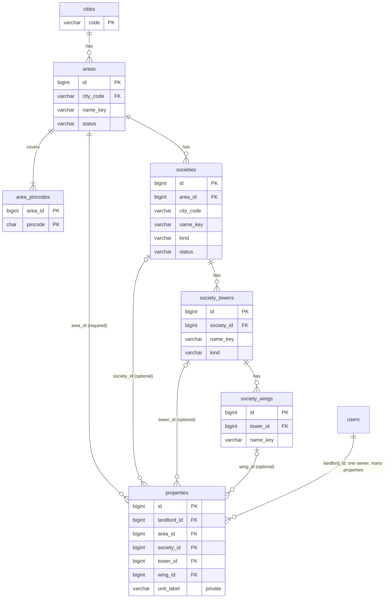
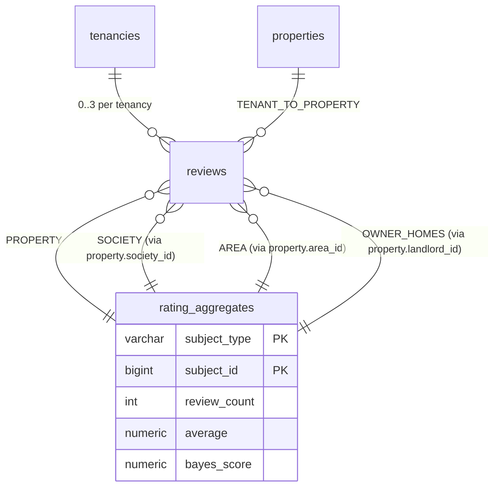
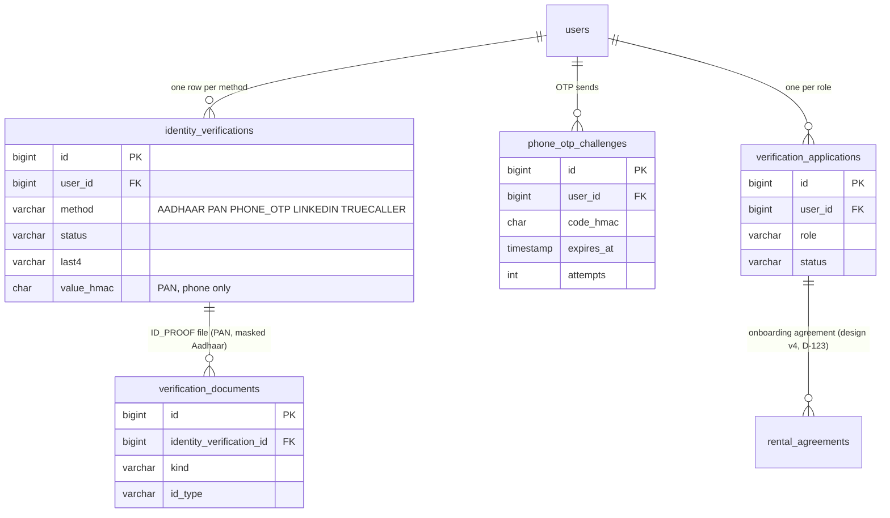

# Rentrix — ER diagrams (design v3)

Status: **current**. Date: 2026-11-22.
Decisions: [`../architecture/SYSTEM_DESIGN.md`](../architecture/SYSTEM_DESIGN.md) §5 and §7.4. Column lists, keys and indexes: [`schema.md`](schema.md).
These diagrams show the design-v3 parts (location hierarchy, owners, roll-ups, identity) and the V1 tables they touch. GitHub renders the Mermaid blocks.

## 1. Location hierarchy

```
City            cities              BLR Bangalore
 └─ Area        areas (+ PIN codes) Koramangala · 560034, 560095
     ├─ Society       societies         Demo Greens (gated community)
     │   └─ Tower/Block   society_towers    Tower 1
     │       ├─ Wing          society_wings     Wing A
     │       │   └─ Unit/Flat     properties        Demo Residency A · unit D-101 (private)
     │       └─ (no wing)     properties        a unit directly in a tower without wings
     └─ Standalone    properties        house, villa or building outside any society
```



Rules: `wing ⇒ tower ⇒ society ⇒ area ⇒ city`, checked by the API (D-110). Standalone properties have `society_id`, `tower_id`, `wing_id` null.

## 2. Ratings and roll-ups



```
 one counted TENANT_TO_PROPERTY review on Demo Residency A
        │ same transaction (D-33, D-111)
        ├─▶ PROPERTY     Demo Residency A
        ├─▶ SOCIETY      Demo Greens
        ├─▶ AREA         Koramangala
        └─▶ OWNER_HOMES  Demo Landlord BLR-1      (LANDLORD person rating stays separate, D-18)
```

## 3. Identity verification



"ID verified" badge = any `AADHAAR`, `PAN` or `PHONE_OTP` row `VERIFIED` (D-99). "LinkedIn verified" badge = the `LINKEDIN` row `VERIFIED` (D-100). Trust writes need an `APPROVED` application for the role and an ID-verified user (D-91, D-105).
