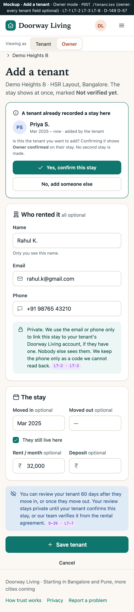
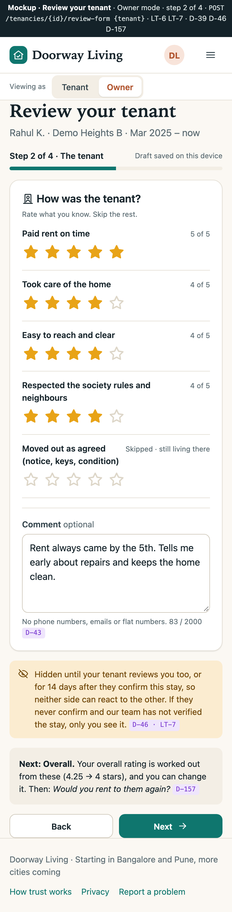
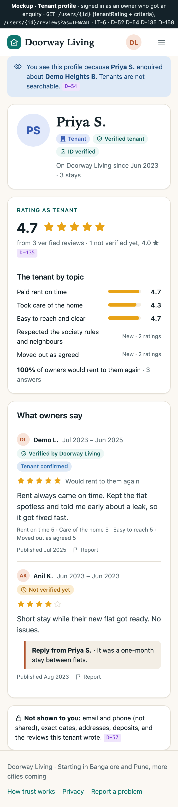
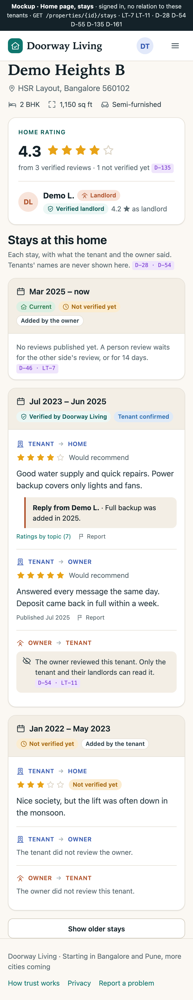

# Landlord adds tenant (design note)

Status: **design, not built**. Date: 2026-11-24. Captain's asks: 2026-11-24 19:30 IST, and the addendum of the same day (OPEN 47 / 53).
Build waits for the stabilisation pass (OPEN 46). Then it ships as the small PRs of §9, each through no-mistakes, DEV first; master releases to LIVE.

This note is written for a developer who joins the codebase today. It maps the captain's model onto the code that exists (§2), lists only the smallest changes that close each gap (§3), decides each scenario (§4–§7), and orders the work into PRs that ship one at a time (§9). It extends SYSTEM_DESIGN §5.4, §6, §7 and §10 and the review form note [`review-form.md`](review-form.md). Rules there stay unless a line below says otherwise.

Decisions proposed here are labelled **LT-1 … LT-12**. Each build PR records the decisions it builds in SYSTEM_DESIGN.md at the next free D-number. D-163 (post with no verification) is taken by the open work on `fm/rxm-no-verify-post`. Note that master already uses D-157 and D-158 twice (review form and delete account).

---

## 0. v1 in short

1. An owner adds a tenant to a home they own, at "I own it" or later from the home. Every field is optional: name, email, phone, dates and rent (from slice S3 on). One exception: writing a review of an undated `ACTIVE` stay needs a move-in month, because the window of a running stay opens 60 days after move-in under the review lock (D-39). The review form's Stay step asks for it then, with the reason shown. An undated `ENDED` stay can be reviewed at once: D-39 already opens the window once a stay has ended. An undated stay is `ENDED` when the owner unticks "They still live here" or ends it later. A dated stay that has ended needs its end date (LT-12).
2. The tenancy stands at once (`ACTIVE` or `ENDED`), one-sided, "Not verified yet", as rule B already decided for both sides (D-149).
3. The email and phone are private. They are used only to link the tenancy to the tenant's account by a **verified** email or phone. The phone is stored only as an HMAC (`ID_HASH_KEY`). The owner never learns whether a link happened.
4. No account matches? The tenancy keeps `tenant_id = NULL`: that is the **unclaimed tenant**. The tenant claims it later by signing in with that email or by verifying that phone.
5. The owner reviews the tenant with the existing review form: a new `tenant` part, `LANDLORD_TO_TENANT`, with 5 parameters.
6. A review about a tenant goes public only when the tenant stands behind the tenancy: they added it, confirmed it, or the team verified it. Then the double-blind reveal of D-46 runs as today.
7. The tenant profile (`/u/:id`, tenant side) shows the tenant's rating, parameter averages and the reviews from owners, to the people D-54 allows.
8. The home page gets one "Stays at this home" list for signed-in viewers: per tenancy, the home review, the owner review and the tenant review, each with its existing visibility rule. Outsiders see only stays with a published review, as a year range. Signed-out viewers see no stays, only the home reviews (as today's rent history, which is signed-in only). The two parties of a stay always see it in full.

---

## 1. The model

```
                    ┌──────────── Home (properties) ────────────┐
                    │  owner = properties.landlord_id           │
                    └──────────────┬────────────────────────────┘
                                   │ 1..N tenancies (one per stay)
                                   ▼
   Owner (tenancies.landlord_id) ◀────── Tenancy ──────▶ Tenant (tenancies.tenant_id, NULL = unclaimed)
        │   ▲                                                      │   ▲
        │   └───── ② TENANT_TO_LANDLORD  (tenant rates the owner) ─┘   │
        └───────── ③ LANDLORD_TO_TENANT  (owner rates the tenant) ─────┘
                   ① TENANT_TO_PROPERTY  (tenant rates the home)
                   each review's subject may post one public reply (§5.7)
```

The captain lists four reviews: tenant → home, tenant → owner, owner → tenant, and the owner side being reviewable by the tenant. The first three are the three `ReviewDirection` values that exist today. We read the fourth as: the tenant can rate the owner on a tenancy **the owner started** too, not only on one the tenant recorded. That works as soon as the tenant is linked (slice S3), because `TENANT_TO_LANDLORD` is blocked only on unclaimed homes (D-139). No new direction, enum value or table is needed.

---

## 2. What already exists

### 2.1 Code map

| Piece | Where | What it does today |
|---|---|---|
| Review directions | `review/ReviewDirection.java` | `TENANT_TO_LANDLORD`, `LANDLORD_TO_TENANT`, `TENANT_TO_PROPERTY` (§1) |
| Who may write which direction | `ReviewService.DIRECTIONS`, `requireCanWrite` | landlord side → `LANDLORD_TO_TENANT` only; tenant side → home and landlord (D-37); `wrong_direction` otherwise |
| Plain review create | `POST /tenancies/{id}/reviews` (`ReviewService.create`) | accepts `LANDLORD_TO_TENANT` with the D-29 sub-ratings and a 30–2000 character body. The web never calls it: `api/homes.ts writeReview` is unused |
| Review form | `POST /tenancies/{id}/review-form` (`ReviewService.form`), `ReviewFormRequest {home?, landlord?}` | tenant only. `ReviewCriterion.of(LANDLORD_TO_TENANT)` is empty |
| Parameter averages | `rating/RatingBreakdowns.forProperty`, `forLandlord` | read-time averages per parameter, D-52 per parameter (D-158) |
| Tenant aggregate | `RatingRecomputer` (`LANDLORD_TO_TENANT` → `RatingSubjectType.TENANT`) | stored row per tenant, recomputed on every review change (D-33) |
| Double-blind reveal | `ReviewService.write`, `revealDue`, `ReviewRevealJob` | a person review waits for its counter-review or 14 days (D-46) |
| Review tasks | `GET /me/review-tasks` (`ReviewService.tasks`) | already lists `LANDLORD_TO_TENANT` tasks for the owner of an `ACTIVE`/`ENDED` tenancy whose window is open (D-39) |
| Received / written | `GET /me/reviews/received?as=`, `/me/reviews/written?as=` | both sides; "pending" stubs for reviews awaiting reveal |
| Tenant profile (API) | `GET /users/{id}` (`tenantRating`), `GET /users/{id}/reviews?as=TENANT` (`UserProfileService`) | visible per D-54 through `ProfileAccess.canSeeTenant`; `404` otherwise (D-60) |
| Tenancy create, either side | `POST /tenancies` (`TenancyService.create`) | owner-initiated: needs `counterpartyEmail` and a rent, stays `PENDING_CONFIRMATION` until the tenant confirms, `EXPIRED` after 14 days (`expirePending`). D-149 says it should stand at once; B20, which builds that, is not built |
| Tenant's own record | `TenancyService.recordOwn` (from `POST /me/homes`) | `ACTIVE`/`ENDED` at once, one-sided, rent optional (D-142) |
| Invites | `invite_tokens`, `InviteTokens`, `POST /tenancy-invites/claim`, `TenancyNotifier.invite` | a single-use emailed link binds the tenancy to the account with the same verified email. Only `LogEmailSender` exists (D-65 build note), so no invite email reaches a real person yet |
| Silent email match | `TenancyService.create` | an existing account with the invited email and the `TENANT` role is set as tenant at once |
| Owner does not see who matched | `TenancyService.view` `tenantHidden` | the owner sees only the masked email (`maskEmail`) until the tenancy is confirmed |
| Unclaimed tenant | `tenancies.tenant_id` | nullable since V1 ("null while a landlord-initiated invite waits") |
| Unclaimed landlord | `property/UnclaimedLandlord.java` | one system account holds tenant-added homes; "Not on Doorway Living yet"; no landlord review there (D-139) |
| Phone hashing | `identity/IdHasher.hmac`, `PhoneOtpService.normalisePhone`, `IdentityService.PHONE_METHODS`, `phoneVerifiedOnOtherAccounts` | E.164 normalising, HMAC-SHA256 with `ID_HASH_KEY`, verified-phone lookups (D-101) |
| Ticks and headline | `verification_status` on tenancies and reviews; `app.ratings.headline` | "Verified by Doorway Living" or "Not verified yet" (D-134); the headline counts green-tick reviews only in `verified` mode (D-135), the default under D-163 |
| Creator edits | `PATCH`/`DELETE /tenancies/{id}` | the initiator edits or deletes; an edit resets the tick (D-156) |
| Account deletion | `account/AccountDeletionService` | tenancies stay with "Deleted user"; `invite_email` cleared on both sides (D-58) |
| Mode switch (#70) | `features/mode/mode.ts`, `ModeSwitch.tsx`, `nav.ts` | Tenant / Owner per user in localStorage; Owner home `/me/dashboard`; `MyTenanciesPage` lists the owner's side. Separate work moves the stored mode to the account (`PATCH /me` preferred mode). This design changes nothing in `features/mode/*`: it reads only `modeSide` (Owner → `LANDLORD`), wherever the mode is stored |
| Review form web (#71) | `pages/WriteReviewPage.tsx`, `features/review/form.ts` | steps Stay → Home → Landlord → Overall → Check; parts from the review tasks; ignores `LANDLORD_TO_TENANT`; draft `rx-review-draft:<tenancyId>` |
| MyReviews (#71) | `features/review/MyReviews.tsx` | labels `LANDLORD_TO_TENANT` as "Tenant"; the owner dashboard has "Reviews you wrote of tenants" (empty: no UI writes one) |
| Landlord page | `pages/LandlordPage.tsx` (`/u/:id`) | landlord side only; the web type `UserProfile` has no `tenantRating` |
| Home page | `pages/PropertyPage.tsx` (`/p/:id`) | rating card + "The home by topic", owner line, rent history (signed in), "What tenants say about the home" (`TENANT_TO_PROPERTY` only, D-161) |
| Invite form | `pages/TenancyRequestPage.tsx` (`/tenancies/new`) | "Invite a tenant": tenant email (required), dates, rent (required), deposit; any published or archived home the owner holds, "I own it" homes too |
| Add home "I own it" | `pages/AddHomePage.tsx?own=1`, `HomeService.add` | address and relation only; no tenant step (`relation=OWN` refuses tenancy fields) |

### 2.2 Each review direction: there and missing

| Direction | Writes today | Reads today | Missing |
|---|---|---|---|
| ① tenant → home | review form, published at once (D-47) | public on the home page (D-161), parameter averages | nothing |
| ② tenant → owner | review form, behind the reveal (D-46) | landlord page `/u/:id`, signed in (D-55) | not on the home page; on an owner-started tenancy the tenant can review only after confirming the pending request |
| ③ owner → tenant | API only, plain review, never called by the web | `/me/reviews/*`, `GET /users/{id}/reviews?as=TENANT` (no web page) | form part and parameters; owner CTA; a tenancy the owner can add without the tenant; the tenant side of `/u/:id`; home page entry; tenant protection when the tenant never joined |

---

## 3. Gaps and the smallest change for each

| # | Gap | Smallest change | Reuses |
|---|---|---|---|
| G1 | The review form has no owner part | `ReviewFormRequest.tenant?`, 5 `ReviewCriterion` values for `LANDLORD_TO_TENANT`, web part "The tenant" | `ReviewService.form`, `review_criterion_ratings`, `form.ts` |
| G2 | The owner cannot find "Review your tenant" | CTA on the tenancy page and card in Owner mode, from `GET /me/review-tasks` | `ReviewCta`, `TenancyCard` |
| G3 | No tenant profile page | `/u/:id` renders the tenant side when `tenantRating` is present; `RatingBreakdowns.forTenant` | `UserProfileService`, `LandlordPage`, `RatingBreakdown` |
| G4 | An owner's tenancy waits for the tenant (`PENDING_CONFIRMATION`, 14-day expiry) | build the owner half of D-149: it stands at once, one-sided | `startOneSided`, `confirmed_at` |
| G5 | The owner must type an email and a rent | contact and rent optional; phone kept as an HMAC; a private name label | `invite_email`, `IdHasher` |
| G6 | Linking needs the emailed link, which is never delivered | silent match on a verified email or phone, at add and later | `users.email`, `identity_verifications.value_hmac` |
| G7 | A fake owner could attach reviews to a real person | a tenant review publishes only on a tenancy the tenant stands behind (LT-7) | D-46 job, `confirmed_at`, the tenancy tick |
| G8 | The same stay recorded twice | `409 tenancy_exists` with the tenancy to confirm instead | `requireHomeFree`, `requireNoOverlap`, confirm |
| G9 | The home page shows only home reviews | one signed-in read, `GET /properties/{id}/stays`, grouped per stay | `ReviewView`, `ProfileAccess.canSeeTenant` |
| G10 | Dates are required (`start_date NOT NULL`) | in S3: nullable `start_date`, undated rules (LT-12) | the V12 vendor rebuild pattern |

No new review table, aggregate table or system account is needed. The only new columns are four on `tenancies` (§8).

---

## 4. Scenarios and decisions

### 4.1 Linking the tenant

```
 owner adds tenant {name?, email?, phone?, dates?, rent?}
        │
        ▼
 tenancy ACTIVE / ENDED at once, one-sided, "Not verified yet"     (LT-1)
        │  match: exactly one active account with this verified email,
        │         or this verified phone (HMAC), and no clash between them   (LT-3)
        ├── match ──▶ tenant_id = that user (silent: the owner still sees
        │             only the masked contact and the name they typed)
        │                 │  tenant sees "Is this you?" in My tenancies
        │                 ├── "Yes, I rented it" ─▶ confirmed_at: "Tenant confirmed",
        │                 │                         TENANT role added, contact cleared
        │                 └── "Not me" ─▶ unlinked again, link_refused_by = user,
        │                                 contact frozen, never matched again,
        │                                 their reviews here detach                (LT-4)
        └── no match ─▶ tenant_id NULL = unclaimed tenant                          (LT-5)
                          │ later: Google sign-in with that email, or the same phone verified,
                          │        or the invite link (when real email exists)
                          └──────▶ linked as above, and the tenant answers as above
```

| Scenario | Decision |
|---|---|
| Tenant already on Doorway, owner typed their Gmail | Linked at once if the account's email is Google-verified (`email_verified_at`). The owner sees the masked email until the tenant confirms (today's `tenantHidden`, now keyed on `confirmed_at`) |
| Tenant already on Doorway, owner typed their phone | Linked if exactly one active account has a `VERIFIED` `PHONE_OTP` or `TRUECALLER` check with that HMAC. Two or more accounts (the `DUPLICATE_PHONE` case): no link |
| Email and phone point to two different accounts | No link. The admin queue card shows "contact matches two accounts" (no names to the owner) |
| Tenant not on Doorway yet | `tenant_id` stays NULL. The owner can still review (§6). Nothing is public about the tenant |
| Tenant signs up later with the same email | Linked at sign-in (`AuthService`, when the account is created or its email changes) |
| Tenant later verifies the same phone | Linked when the phone check turns `VERIFIED` (`PhoneOtpService.markVerified`, `TruecallerService`) |
| Tenant uses a different email and phone | No match. The owner edits the contact (LT-9), or the tenant asks the owner. An admin link tool is not in v1 |
| Matched account lacks the `TENANT` role | Linked anyway. The role is added when they answer "Yes, I rented it" (fresh `accessToken`, as `POST /me/homes` does). Until then no tenant profile exists for them (`tenantVisible` needs the role) |
| The owner typed their own email or phone | `422 invite_self` on the field, as today |
| Matched account is deleted, suspended or the unclaimed-homes account | Never linked |
| Wrong person linked | The person answers "Not me" (LT-4). The tenancy is then never matched again, and its contact is frozen: the owner cannot point it at another email or phone, so a refused address can never be re-linked to that stay. To try a new contact, the owner deletes the stay and adds a new one (D-35 add limits apply). The owner sees "Not linked yet", the same words as "no match" |
| Tenant disputes the facts (dates or rent are wrong) | They answer "Yes, I rented it" only if the stay is theirs, then "Report a problem" (`FAKE_TENANCY` or `OTHER`, SYSTEM_DESIGN §8), or ask the owner to edit. No counter-offer flow (D-34) |
| Tenant declines a correct link to dodge a bad review | The review detaches and waits, unpublished. The owner can upload the rental agreement so the team verifies the tenancy (D-147), but re-linking that tenant needs an admin link tool, which is not in v1 (§12). v1 accepts this gap: wrongly attaching a review to someone is the worse failure |

### 4.2 Both sides record the same stay

| Case | Decision |
|---|---|
| Tenant recorded the stay first (one-sided, D-142); the owner now adds a tenant on the same home with overlapping dates, or with no dates | The add form lists the home's one-sided tenant records that overlap; an undated add lists all of the home's standing one-sided tenant records: "A tenant already recorded a stay here: Priya S. · Mar 2024 – now. Is this them?" "Yes" calls confirm on that tenancy ("Owner confirmed", LT-8). If the typed contact matches the tenant of a standing one-sided tenant record on the home, `POST /tenancies` itself answers `409 tenancy_exists` with that tenancy's id (the owner is its party), whether or not the new stay has dates. This tells the owner only that the contact belongs to a tenant who already recorded a stay on their own home. "No, add a new tenant" creates the new row; D-142 lets both stand and the admin card shows the overlap |
| Owner added the stay first; the tenant now records it through "Add your home" | If the owner's tenancy is linked to the caller, or its contact matches the caller's verified email or phone, `recordOwn` answers `409 tenancy_exists` with that id: "Your owner already added this stay. Confirm it." Otherwise the owner's tenancy holds the dates (owner-started, D-142), so the existing `409 tenancy_overlap` answers with the period only: "The owner recorded a tenant for these dates. If it was you, ask them to add your email or phone." |
| The same flat exists twice (a tenant added it as unclaimed, the owner added it again with "I own it") | Not merged in v1. Claiming an unclaimed home stays an admin step (D-139). The owner's tenants go on the owner's row |

### 4.3 Fake owner claims

An attacker adds a home, says "I own it", adds a victim's email and writes a bad review. The defences, in order:

1. The review stays private to its author while the tenant has not stood behind the tenancy (LT-7). A tenant who never answers is never shown.
2. "Not me" detaches it at once (LT-4).
3. Headlines count only green-tick reviews (D-135; `verified` is the default under D-163). The team ticks a tenancy from its rental agreement (D-147).
4. The add limits of D-35 apply to owner adds (5 per 24 h, 20 per 30 days, `429`), and the review volume guard of D-45.
5. Reports and admin void (D-36, D-49, D-51).

No one can add a tenant on an unclaimed home: its owner is the system account, so `asLandlord` is never true there.

### 4.4 Edit, delete and account deletion

| Event | Effect |
|---|---|
| Owner edits the tenant contact (LT-9) | Allowed while the tenant has not confirmed and no one answered "Not me" (`link_refused_by` is NULL). A changed email or phone drops an unconfirmed link and matches again. After "Tenant confirmed": `422 tenant_confirmed` on the contact fields. After "Not me": `422 contact_frozen`; the owner may delete the stay and add a new one |
| Owner edits dates or rent | D-156 as today: the creator edits, the tick resets, the edit history keeps it |
| Owner deletes the tenancy | D-156: refused once the tenant confirmed (`409 confirmed_by_other_side`) or reviewed (`409 tenancy_has_reviews`); otherwise `CANCELLED` and the owner's own tenant review is withdrawn |
| Tenant answers "Not me" | Unlinked; `link_refused_by` set, which freezes the contact and stops all later matching on this tenancy; a review about them on this tenancy gets `subject_user_id = NULL` and waits again; their own reviews on it are withdrawn (they say they never lived there) |
| Tenant deletes their account | D-58 unchanged: tenancies and reviews stay; the tenant shows as "Deleted user" |
| Owner deletes their account | D-58: the home moves to the unclaimed account; tenancies stay with "Deleted user". New: `tenant_name`, `invite_phone_hmac` and `invite_phone_last4` are cleared with `invite_email`, so an unclaimed tenancy of a deleted owner can never be linked |
| Admin voids the tenancy | D-36 unchanged: all its reviews leave the aggregates and the stays list |

---

## 5. Privacy

| Data | Stored as | Who sees it | When it goes |
|---|---|---|---|
| Tenant email the owner typed | `tenancies.invite_email`, lower-case (exists) | the owner masked (`p***@g***.com`), admins in full | cleared when the tenant confirms (its purpose is done), on the owner's deletion (D-58), on an owner edit |
| Tenant phone the owner typed | `invite_phone_hmac` (HMAC-SHA256, `ID_HASH_KEY`) + `invite_phone_last4`. The number itself is never stored | the owner and admins: `+91 XXXXXX3210` | as the email |
| Tenant name the owner typed | `tenant_name`, ≤ 80 characters | the owner and admins only. The public never sees it; the linked tenant sees "as you were named: …" so they can recognise the stay | as the email |
| Who matched | `tenant_id` | the linked tenant; the owner only after "Tenant confirmed" (then the tenant's short name, D-28) | — |

- Matching is silent. No answer, status or timing tells the owner whether an email or phone has an account. "Not linked yet" covers no match, two matches and "Not me". One exception: after "Not me" a contact edit answers `422 contact_frozen`, so an owner who tries to edit learns that someone refused. v1 accepts this, because it is what stops an owner from re-pointing a stay at a person who refused it.
- No `ID_HASH_KEY` set: the phone field is hidden, like the Truecaller button (D-138).
- Logs never hold the typed email or phone; they log the tenancy id only (as D-65 masks recipients).
- Contact is used only to link (and later to send one invite when `SmtpEmailSender` exists). It is never in a public response, a search, a card or a review (D-57).
- An owner → tenant review is never readable by people D-54 does not allow, on any page (§7).

---

## 6. Review timing and reveal

- **Window**: D-39 unchanged: the owner reviews 60 days after the start or once the tenancy ended; it never closes.
- **Form**: a `tenant` part of the existing form (LT-6). Parameters, each optional 1–5:
  - `RENT_ON_TIME` "Paid rent on time"
  - `CARE_OF_HOME` "Took care of the home"
  - `COMMUNICATION` "Easy to reach and clear"
  - `HOUSE_RULES` "Respected the society rules and neighbours"
  - `MOVE_OUT` "Moved out as agreed (notice, keys, condition)"

  The overall rating is required and worked out as today. "Would you rent to them again?" fills `would_recommend`. The comment is optional. Pros and cons are refused on this part (`422 not_allowed`), so all person text stays behind the reveal, as for the landlord part.
- **Publishing (LT-7)**: an owner → tenant review stays `AWAITING_REVEAL`, visible only to its author, until the tenancy is **tenant-backed**: a tenant is linked **and** (the tenant initiated it, **or** `confirmed_at` is set, **or** `verification_status = VERIFIED`). From then D-46 runs: it publishes with the tenant's review of the owner, or 14 days after the later of its submission and the backing time. The backing time is read from existing columns (`created_at` for a tenant-initiated tenancy, `confirmed_at`, `verification_decided_at`). The reveal job filters these in Java, bounded like today; no new column.
- **Unclaimed tenant**: the review is saved with `subject_user_id = NULL`. On link it gets the tenant as subject. It never publishes while unclaimed, and it counts in no aggregate. `RatingRecomputer` skips a person review whose subject is NULL (today an edit or a withdraw would fail on it).
- **Tenant → owner** on an owner-added tenancy: unchanged D-46. The owner started the tenancy, so it is owner-backed.
- **Headline**: unchanged D-135: in `verified` mode only reviews with the tick count; others show "Not verified yet".

---

## 7. What the home page shows

`GET /properties/{id}/stays` (signed in only, `401` signed out, as rent history; LT-11) returns the standing tenancies of the home (`ACTIVE`, `ENDED`; not `CANCELLED` or `VOIDED`; undated ones only to their parties), newest first, 20 per page. Each stay is keyed by its period, never by a tenancy id (D-28): `{period, verification, ownerConfirmed, tenantConfirmed, addedBy: OWNER|TENANT, home, owner, tenant, mine}`. Each review is the existing `ReviewView` under its existing rule. The web section "Stays at this home" replaces "What tenants say about the home" for signed-in viewers and keeps the `#reviews` anchor of D-161.

What a viewer sees of the stays themselves (the period is the part that could identify a tenant, §12):

- **The stay's two parties** (its tenant and the home's owner) and admins: every stay they are party to, in full. `period` is month-precise with `current: true` for a running stay ("Mar 2025 – now · Current"). An undated stay shows "Dates not given".
- **Every other signed-in viewer**: only stays with at least one published review. `period` is a year range `{fromYear, toYear}` ("2023 – 2025"), never a month and never `current`. A running stay shows the current year as `toYear`, so it reads like any stay that ended this year.
- **Signed out**: no stays list, no periods and no current occupancy. The page keeps today's "What tenants say about the home" list (D-161) with "Sign in to see the stays at this home".

| Viewer | Stays listed | ① home review | ② review of the owner | ③ review of the tenant | Tenant identity |
|---|---|---|---|---|---|
| Signed out | none | full, in today's list (D-161) | not shown | not shown | never |
| Signed in, no relation | with a published review; year range | full | full once published (D-55) | `{exists}`: "The owner reviewed this tenant. Only the tenant and their landlords can read it." | never |
| The stay's tenant | their own in full; others as "no relation" | full; "Your review" actions | full; their own review with actions | full once published; while it waits only "A review about you is waiting" (D-46) | themselves |
| The home's owner | all stays on the home, in full | full; reply action | full; reply action | full; "Your review" actions | after "Tenant confirmed": short name |
| A landlord D-54 allows (an open enquiry from this tenant, or this tenant's landlord elsewhere) | as "no relation" | full | full | full | never on the home page; the tenant profile shows it |
| Admin (admin host only) | all, in full | full | full | full | full |

`{exists}` is sent only for published reviews. A waiting review is invisible to everyone except its author and the bare "pending" stub for its subject (D-46).

---

## 8. API and database changes

### 8.1 API

| Change | Slice |
|---|---|
| `POST /tenancies/{id}/review-form` takes `tenant?: Part` (landlord side); `ReviewFormView.tenant`. At least one part, as today | S1 |
| `ReviewCriterion` gains the 5 tenant parameters; `GET /users/{id}` `tenantRating` gains `criteria` and `recommend` (`RatingBreakdowns.forTenant`) | S1, S2 |
| `GET /me/review-tasks`: a task's `counterparty` may be `{id: null, shortName: "Your tenant"}` for an unclaimed tenant | S1 guard, S3 |
| `POST /tenancies` by the home's owner: `counterpartyEmail`, `initialRentInr`, `startDate` and `endDate` optional; new optional `counterpartyPhone`, `counterpartyName` and `livesThere` (the form's "They still live here"); answers `ACTIVE`/`ENDED`, no invite expiry. Status: an end date gives `ENDED` as today; with no end date, `livesThere: false` gives `ENDED` with `end_date` NULL and `ended_at` set, but only when there is also no `startDate`; a dated add with `livesThere: false` and no `endDate` answers `422` on `endDate`. `true` or absent gives `ACTIVE`. One rule holds everywhere: a stay with a start date is `ENDED` only with an end date. Only an undated stay may be `ENDED` with `end_date` NULL, and then `ended_at` marks it as ended. | S3 |
| `confirm`, the one-sided record path and `PATCH /tenancies/{id}` stop working the status out from `end_date` alone: an undated row that `ended_at` marks as ended stays `ENDED`. A `PATCH` that adds a start date to such a row needs an end date too (`422` on `endDate`) | S3 |
| `POST /tenancies/{id}/end` accepts a tenancy with a NULL start date: it skips the `before_start` check, so the end date must only not be in the future | S3 |
| `409 tenancy_exists {tenancyId}` from owner add and from `recordOwn`, only to a party of that tenancy. The contact match runs whether or not the new stay has dates; it does not depend on overlap | S3 (owner), S4 (tenant) |
| `POST /tenancies/{id}/confirm` also works on a one-sided `ACTIVE`/`ENDED` tenancy by the other party: sets `confirmed_at` ("Tenant confirmed" / "Owner confirmed", D-149) | S3 |
| `POST /tenancies/{id}/not-me` only on a tenancy with `initiated_by = LANDLORD` that the caller was linked to by matching the owner's typed contact (silent match or invite claim), not yet confirmed by the caller and without the tick: unlink (§4.4); never gated. On a tenancy the tenant started: `409 invalid_transition` | S3 |
| `TenancyView` gains `tenantLabel` (the typed name, owner only), `invitePhone` (masked, next to the existing masked `inviteEmail`), `linkState: NONE \| WAITING \| CONFIRMED` (owner: `WAITING` covers both "linked, not confirmed" and "not linked"), `actions.confirm`, `actions.notMe` | S3 |
| `PATCH /tenancies/{id}` takes `tenant {name?, email?, phone?}` (LT-9). A changed email or phone answers `422 tenant_confirmed` after the tenant confirmed and `422 contact_frozen` after "Not me" (`link_refused_by` set) | S3 |
| `POST /tenancy-invites/claim` also accepts a one-sided `ACTIVE`/`ENDED` owner-started tenancy with `tenant_id` NULL, so invite tokens sent before S3 keep working. It refuses a tenancy with `link_refused_by` set | S3 |
| An undated tenancy (no `startDate`): left out of rent history, overlap checks and the stays of non-parties; an undated `ACTIVE` tenancy's review needs a move-in month first (`422 start_date_required`; the form's Stay step asks for it, with the reason: a running stay's window opens 60 days after move-in, D-39). An undated `ENDED` tenancy is reviewable at once (D-39). `ReviewWindow.opensOn` / `isOpen` handle a NULL start date: open when the stay is `ENDED`, not open (`422 start_date_required`) when it is `ACTIVE` | S3 |
| Link on sign-in and on phone verify: a `ContactVerified(userId)` event from `AuthService` and the phone methods; a `TenantLinker` listener links matching unclaimed tenancies in the same transaction, skipping any with `link_refused_by` set | S4 |
| `GET /properties/{id}/stays` (§7), signed in only; periods as year ranges and only reviewed stays for non-parties | S5 |
| `POST /me/homes` with `relation=OWN` stays address-only; the web continues to "Add your tenant (optional)" with `POST /tenancies` | S4 |

#### Undated stays: code that reads `start_date`

S3 makes `start_date` nullable. Every server site that reads it gets one undated rule (LT-12). A site not in this list must not read it.

| Site (today's code) | Undated rule |
|---|---|
| `TenancyService.create` / `requireDates` | the owner add accepts no dates (§8.1 `POST /tenancies` row); the tenant's own record and the invite path keep their date rules |
| `TenancyService.confirm` (first rent record) | writes no rent record; the rent stays on `initial_rent_inr` only |
| `TenancyService.startOneSided` (first rent record) | as `confirm`: no rent record |
| `TenancyService.update` / `syncFirstRecord` / `requireRecordsFit` | no first record while undated. A `PATCH` that sets a move-in month writes the first record from that month, as for a dated stay |
| `TenancyService.end` (`before_start`) | skipped when no start date is held (§8.1 end row) |
| `TenancyService.requireHomeFree`, `requireNoOverlap`; `TenancyRepository` overlap queries (lines 60, 71: `t.startDate <= :end`) | a NULL start never matches, so an undated stay holds no dates and never clashes. This is intended. An undated new stay skips both checks |
| `TenancyService.delete` (edit history text) | "Dates not given" instead of the period |
| `TenancyService.view` (`currentRentFrom`) | NULL for an undated stay; the rent shows without a "from" month |
| Expiry (`expirePending`) | unaffected: owner adds no longer wait (LT-1), and it reads `created_at` |
| `RentRecordService` (lines 176, 181: first record month) | adding a rent record to an undated stay answers `422 start_date_required` |
| `ReviewWindow.opensOn` / `isOpen` | open when `ENDED`, not open (`422 start_date_required`) when `ACTIVE` (§8.1) |
| `ReviewService.period` (line 853, `YearMonth.from(start)`) and `ReviewService.tasks` (sorts by `period().from()`) | an undated stay has no period ("Dates not given") and sorts last |
| `RatingRecomputer` (line 51, repeat-pair rule D-44 orders by start date) | an undated tenancy orders by its `created_at` |
| `TenancyNotifier` (lines 46, 57, 89: email text) | leaves the date out when there is none |
| `AdminQueueService` (line 284: queue card text) | "Dates not given" |
| `HomeService` (add-home tenant path, three reads) | unchanged: the tenant's add-home still asks for the move-in date (D-139) |

### 8.2 Database (Flyway, next free version when each PR merges; master is at V17)

- **S1, S2**: no migration. `review_criterion_ratings.criterion` is `VARCHAR(32)` with no `CHECK` (V16), so new parameter names need no DDL.
- **S3** `V<n>__tenant_contact.sql` (portable subset, D-10):
  - `ALTER TABLE tenancies ADD COLUMN tenant_name VARCHAR(80);`
  - `ALTER TABLE tenancies ADD COLUMN invite_phone_hmac CHAR(64);`
  - `ALTER TABLE tenancies ADD COLUMN invite_phone_last4 VARCHAR(4);`
  - `ALTER TABLE tenancies ADD COLUMN link_refused_by BIGINT REFERENCES users (id);` plus `db/vendor/mysql/V<n>_1__tenant_contact_fks.sql` for the foreign key (MySQL ignores inline `REFERENCES`, D-114)
  - `start_date` nullable through the vendor rebuild files, as V12 did for the rent
  - `CREATE INDEX ix_tenancies_invite_email ON tenancies (invite_email);` and `ix_tenancies_invite_phone ON tenancies (invite_phone_hmac);` for the later match
  - data: owner-started `PENDING_CONFIRMATION` rows become `ACTIVE`, or `ENDED` with an end date, without `confirmed_at` (the owner half of B20's planned move). Their invite tokens stay usable as links: S3 widens the claim to these rows (§8.1).
- **S6**: no migration.

---

## 9. PR slices, in order

Each slice is small, ships alone, needs no flag and no flag day, and keeps every existing flow working.

| Slice | What ships | Server | Web | Migration |
|---|---|---|---|---|
| **S1** (a) Owner reviews own tenants | "Review your tenant" on tenancies the owner already has: tenant-recorded stays on their home and confirmed invites | `tenant` form part, 5 criteria, review-task and recompute NULL guards | form part "The tenant" (owner copy), CTA on `TenancyPage` / `TenancyCard` in Owner mode, draft key `rx-review-draft:<tenancyId>:LANDLORD` | none |
| **S2** (b) Tenant profile | `/u/:id` shows the tenant side: rating, "The tenant by topic", "Would rent to them again", "What owners say"; links from the owner's confirmed tenancy and from the tenant's MyReviews | `RatingBreakdowns.forTenant` in `GET /users/{id}` | `UserProfile.tenantRating`, a tenant section in `LandlordPage` | none |
| **S3** (c1) Owner adds a tenant | the "Add a tenant" form with every field optional, dates included; stands at once; silent link at add; "Is this you?" for the tenant; LT-7 reveal; `409 tenancy_exists` on owner add; undated stays (LT-12) | `TenancyService.create` owner branch, `not-me`, confirm on one-sided rows, claim on one-sided owner rows, contact columns and freeze, reveal filter, undated guards (`livesThere`, end without a start date, `ReviewWindow` on a NULL start date, status kept from `ended_at` in confirm, record and `PATCH`, no rent record until a move-in month is set; every `start_date` reader in §8.1 "Undated stays"), deletion erase list | `TenancyRequestPage` becomes "Add a tenant" with optional dates; tenant card "Is this you?"; move-in month in the review form's Stay step for undated `ACTIVE` stays; copy of D-153 ("Nothing is public until both sides confirm" goes) | `V<n>__tenant_contact.sql` (with nullable `start_date`) |
| **S4** (c2) Unclaimed tenant claims later | link at Google sign-in and phone verify; the tenant's add-home dedupe; "Add your tenant (optional)" after "I own it" | `ContactVerified` + `TenantLinker`; `recordOwn` `409 tenancy_exists` | add-home OWN continues to the tenant step; "Your owner already added this stay" | none |
| **S5** (d) Whole picture on the home page | "Stays at this home": every direction per stay (§7) | `GET /properties/{id}/stays` | stays section replaces the home review list, keeps `#reviews` and the author actions | none |
| **S6** (e, later) Undated polish | "Add the move-in month" nudge on undated tenancy cards and the owner dashboard. Nothing in v1 needs it | none | the nudge | none |

S1 and S2 can ship in either order. S3 needs S1 only for the owner's CTA copy. S5 needs S3 for owner-added stays but works with today's data too.

---

## 10. Screens

Static mockups on the design tokens (`tokens.css`) and the icon set (`icons/icons.js`), 390 px first. Sources: `rentrix-docs/design/mockups/lat-*.html`. Renders: `rentrix-docs/screenshots/landlord-adds-tenant/`, made with a local headless Chromium (Playwright) at 390 × 844, scale 2, full page.

**Add a tenant** (S3): every field optional, privacy said in place, the dedupe card on top.


**Owner reviews the tenant** (S1): step "The tenant" of the existing form, owner copy, reveal notice.


**Tenant profile** (S2): seen by an owner with access through an enquiry (D-54).


**Home page, stays** (S5): signed in, no relation to the tenants.


Copy uses "owner" in Owner-mode screens and keeps the existing "Landlord" badge on public review labels, as the app does today.

---

## 11. Tests

API tests in `rentrix-server` for each rule above, and Playwright e2e at 390 px on the seeded dev stack, with screenshots to `rentrix-docs/screenshots/landlord-adds-tenant/`:

| Spec (slice) | Checks |
|---|---|
| `owner-reviews-tenant.spec.ts` (S1) | Owner mode → tenancy → "Review your tenant" → 5 parameters → overall → submit → "Waiting for the other side"; tenant reviews the owner → both publish; owner's "Reviews you wrote of tenants" lists it; no horizontal scroll at 390 px |
| `tenant-profile.spec.ts` (S2) | owner with access opens `/u/:id` and sees "What owners say"; a stranger gets the not-found page (D-54, D-60); the tenant sees their own |
| `add-tenant.spec.ts` (S3) | add with no contact and no dates → `ACTIVE`, "Not linked yet", "Dates not given"; add with a seeded tenant's email → the owner still sees the masked email; tenant signs in → "Is this you?" → "Yes, I rented it" → "Tenant confirmed" and the owner sees the short name; "Not me" → unlinked; old "Invite a tenant" deep link still works |
| `tenant-review-backing.spec.ts` (S3) | owner reviews an unlinked tenant → "Waiting for the other side" and nothing on the tenant's side; after link and "Yes, I rented it" the tenant sees "A review about you is waiting"; the tenant reviews the owner → both publish. The 14-day path is an API test (the reveal job is called directly, D-08) |
| `claim-later.spec.ts` (S4) | owner adds an email with no account; a new user signs up with it → linked; the tenant's "Add your home" on that home → "Your owner already added this stay"; "I own it" → "Add your tenant (optional)" |
| `home-stays.spec.ts` (S5) | the §7 matrix: signed out sees no stays and no periods; a signed-in stranger sees only reviewed stays, as year ranges, with no "Current"; the tenant and the owner see their stays in full; the tenant's name never appears for outsiders; `#reviews` still opens the author's review |
| existing specs | `invite-form`, `review-form`, `review-visible`, `tenancy-overlap`, `edit-own-entries`, `delete-account`, `mode-switch` stay green in every slice |

API tests to add, beyond the e2e: phone match with one, two and zero accounts; email and phone on different accounts; `invite_self`; deleted or suspended match; after "Not me" no later match or invite claim re-links the tenancy, and a contact `PATCH` answers `422 contact_frozen` (owner edits A → B → A cannot re-link A); `not-me` on a tenant-started tenancy answers `409 invalid_transition` and leaves its owner review published; an invite token issued before S3 still claims the migrated `ACTIVE` row; an undated stay is left out of rent history, overlap and a stranger's stays, an undated `ACTIVE` stay's review answers `422 start_date_required` until a move-in month is set; an undated owner add with `livesThere: false` is `ENDED` with no end date and its review is accepted at once; a `PATCH` (name, contact or rent) and a tenant confirm on that undated `ENDED` stay keep it `ENDED`, and its review is still accepted; an undated owner add with a rent, then a tenant confirm, writes no rent record and does not error, and a later `PATCH` with a start date writes the first record from that month; adding a rent record to an undated stay answers `422 start_date_required`; an undated stay's review task shows "Dates not given" and sorts last; a dated owner add with `livesThere: false` and no `endDate` answers `422` on `endDate`, so no dated stay runs open-ended and blocks later stays on the home; ending an undated `ACTIVE` stay through `POST /tenancies/{id}/end` works (no `before_start` error) and its review is then accepted; an owner add with no dates whose contact matches the tenant of a one-sided tenant record on the home answers `409 tenancy_exists` with that tenancy's id; `GET /properties/{id}/stays` answers `401` signed out and returns year ranges without `current` to a stranger; pros/cons `not_allowed` on the tenant part; `wrong_direction` for a tenant using the tenant part; NULL-subject review edit and withdraw; the S3 data migration on `PENDING_CONFIRMATION` owner rows; owner deletion clears the new columns; logs never contain the typed contact.

---

## 12. Not in v1, and points for master

- **Not in v1**: sending invites (no `SmtpEmailSender` yet, D-65; no SMS invites); an admin tool to link or re-link a tenant by hand (so a tenant who wrongly answers "Not me" stays unlinked until it exists); merging two rows of the same flat (home claim, D-139); co-tenants on one tenancy (D-23); a tenant reviewing the owner of an unclaimed home (D-139).
- **For master to confirm** (the design assumes the first option):
  1. Tenant reviews publish only on tenant-backed tenancies (LT-7). The mirror for owners, where a review about an owner who never confirmed publishes after 14 days, stays as today.
  2. Outsiders see only "The owner reviewed this tenant" on the home page, not its stars or text (§7, D-54). The open flat number (D-140) and the stay period would let neighbours identify the tenant.
  3. Stays on the home page are signed-in only, and outsiders see only stays with a published review, as year ranges, never "Current" (§7, LT-11). This is the conservative default, matching today's signed-in-only rent history. Master can loosen it.
  4. An undated `ACTIVE` stay needs a move-in month before its review, because under D-39 a running stay's window opens 60 days after move-in (LT-12). An undated `ENDED` stay needs none: its window is already open. An undated stay is `ENDED` through `livesThere: false` at add or the end action, and confirm or `PATCH` keep it `ENDED` (§8.1). The alternative is to count the window from the stay's creation for undated `ACTIVE` stays. The lock itself stays until the captain decides otherwise.
- **Later option**: a per-user refusal list, so a person who answered "Not me" is never matched to any stay of that owner again. v1 freezes only the refused stay's contact (LT-4, LT-9).

---

## 13. Decisions to record (LT → D-number at build)

- **LT-1** An owner's tenancy stands at once, one-sided (owner half of D-149); the tenant's confirmation is the optional `confirmed_at`.
- **LT-2** Tenant contact is optional and private: email as today, phone only as HMAC + last 4, a private name label; cleared when the tenant confirms.
- **LT-3** Silent matching on a verified email or phone, exactly one account, no clash, never the owner; the owner cannot tell whether it matched.
- **LT-4** The linked tenant answers "Yes, I rented it" (adds `TENANT`) or "Not me". "Not me" exists only on owner-started tenancies (`initiated_by = LANDLORD`) the tenant was linked to by matching. It unlinks, freezes the contact and stops all later matching on that tenancy.
- **LT-5** An unclaimed tenant is `tenant_id = NULL`; no system account.
- **LT-6** The review form's `tenant` part with `RENT_ON_TIME`, `CARE_OF_HOME`, `COMMUNICATION`, `HOUSE_RULES`, `MOVE_OUT`; no pros or cons on it.
- **LT-7** An owner → tenant review publishes only on a tenant-backed tenancy; then D-46.
- **LT-8** The same stay recorded twice answers `409 tenancy_exists`, and the other side confirms instead.
- **LT-9** The owner edits the tenant contact until the tenant confirms or anyone answers "Not me" (`422 contact_frozen`); then the owner can only delete the stay and add a new one.
- **LT-10** Account deletion also clears `tenant_name` and the phone columns.
- **LT-11** `GET /properties/{id}/stays` (signed in only) shows every direction per stay under its existing visibility rule. Outsiders see only stays with a published review, as year ranges without month or "Current"; the two parties see their own stays in full; tenant identity never on the home page for outsiders.
- **LT-12** Dates are optional from S3: an undated stay holds no dates, is left out of rent history, overlap checks and the stays of non-parties, and, while `ACTIVE`, needs a move-in month before its review. This is the one exception to "every field optional": under the review lock (D-39) a running stay's window opens 60 days after move-in, so the review form's Stay step asks for the month at review time, with that reason shown. An undated `ENDED` stay is reviewable at once, because D-39 already opens the window once a stay has ended. An undated stay becomes `ENDED` through `livesThere: false` at add (no end date needed) or through the end action, which skips the `before_start` check when no start date is held. `ReviewWindow` treats a NULL start date as open when `ENDED` and as not open when `ACTIVE`. One rule holds everywhere: a stay with a start date is `ENDED` only with an end date. Only an undated stay may be `ENDED` with `end_date` NULL, and then `ended_at` marks it as ended. Confirm, the one-sided record path and `PATCH` keep that status from `ended_at` instead of working it out from `end_date` alone. An undated stay keeps its rent on `initial_rent_inr` only and writes no rent record; the first record is written when a `PATCH` sets a move-in month. Every server site that reads `start_date` follows the list in §8.1 "Undated stays: code that reads `start_date`".
