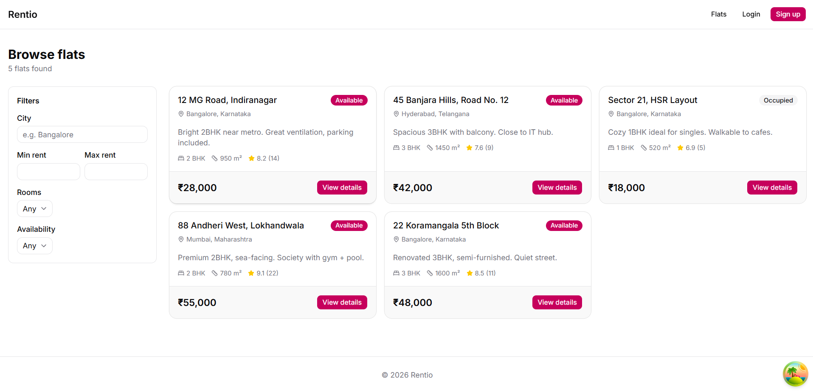

# React + TypeScript + Vite + shadcn/ui

## API base URL

All API calls go through one client (`src/api/client.ts`), which takes its base
URL from `src/lib/apiConfig.ts`. The API origin is resolved in this order:

1. `window.__RENTRIX_CONFIG__.apiBaseUrl` from `public/config.js` (runtime, no rebuild)
2. `VITE_API_BASE_URL` (build time, see `.env.example`)
3. Empty: same origin as the page, so calls go to the relative path `/api/v1`

The value is the origin only (for example `https://api.example.com`); the app
appends the server context path `/api/v1`. A value that already ends in
`/api/v1` also works.

When the web app and the API are on different origins, the API must allow the
web app's origin in its CORS settings (`app.cors.allowed-origins` in
`rentrix-server`).

## Run locally

```bash
npm ci
npm run dev            # http://localhost:5173
```

Leave `VITE_API_BASE_URL` empty. The Vite dev server proxies `/api` to the
local Spring Boot server on `http://localhost:8080`, so no CORS setup is needed.

## Deploying as static files

`npm run build` writes plain static files to `dist/`. Upload `dist/` to any
static host or CDN; no server process is needed.

- **API location**: by default the bundle calls `/api/v1` on its own origin,
  so route `/api` to the API (reverse proxy or CDN rule). For split hosting,
  set `VITE_API_BASE_URL` at build time, or edit `config.js` in the deployed
  `dist/` to point the same bundle at another API.
  Serve `config.js` with a short cache lifetime (for example
  `Cache-Control: no-cache`); hashed files in `assets/` can be cached forever.
- **SPA fallback**: the app uses client-side routing, so the host must serve
  `index.html` for any path that is not a real file (for example `/flats/12`).
  Examples: nginx `try_files $uri /index.html;`, Netlify-style `_redirects`
  line `/* /index.html 200`, S3 + CloudFront custom error response
  403/404 -> `/index.html` with status 200. `vercel.json` already does this
  for Vercel.


This is a template for a new Vite project with React, TypeScript, and shadcn/ui.

## Adding components

To add components to your app, run the following command:

```bash
npx shadcn@latest add button
```

This will place the ui components in the `src/components` directory.

## Using components

To use the components in your app, import them as follows:

```tsx
import { Button } from "@/components/ui/button"
```
